# Arte na Rua v2

Aplicativo Android (Kotlin + Jetpack Compose) que funciona como um **catálogo pessoal de arte urbana de São Paulo**. Global Solution 2026 (2º semestre) — desafio CitizenTech, disciplina Android Kotlin Developer.

## Integrantes

| Nome completo | RM |
|---|---|
|Caio Vinicius Magalhães Leria | 557833 |
|Cesar Brasil Alves | 556236 |

## Problema, público e proposta

- **Problema:** a arte de rua é patrimônio cultural urbano, mas é efêmera (os muros são repintados) e pouco documentada. Muita gente passa por ela sem saber quem é o artista, o que a obra conta ou quando foi feita.
- **Público beneficiado:** moradores e visitantes de São Paulo interessados em cultura urbana, estudantes e turistas.
- **Proposta:** reunir em um só lugar as informações de cada obra (artista, história, período, local) e permitir que o cidadão mantenha o próprio registro — favoritando, comentando e cadastrando novas obras — para ajudar a preservar a memória delas.

## ODS

**ODS 11 — Cidades e Comunidades Sustentáveis**, meta 11.4 (proteger e salvaguardar o patrimônio cultural). O app documenta e divulga a arte urbana como patrimônio cultural da cidade e incentiva o cidadão a participar do registro dela.

## Funcionalidades

- **Home** com a apresentação do projeto e navegação inferior (bottom bar).
- **Listagem de obras** em cards, com botão de favoritar e filtro **Todas / Favoritas**.
- **Detalhe da obra** com dados da obra, do artista, a história e um **comentário pessoal** (adicionar, editar, remover; máx. 500 caracteres).
- **Cadastro de obra** com validação dos campos obrigatórios (nome, autor e história).
- **5 obras de São Paulo** carregadas no banco na primeira abertura (seed).
- **Persistência local com Room:** obras, favoritos e comentários continuam lá depois de fechar o app. Funciona offline e sem permissões.

## Tecnologias e arquitetura

Kotlin · Jetpack Compose + Material 3 · Navigation Compose · Hilt · Room · Coroutines + Flow · KSP.

Arquitetura **MVVM**:

```
┌──────────────────────────────────────────────────────────┐
│ View (ui/)                                               │
│ Composables sem regra de negócio.                        │
│ Observam UiState e enviam eventos para a ViewModel.      │
└───────────────┬──────────────────────────▲───────────────┘
                │ eventos (funções)        │ StateFlow<UiState>
┌───────────────▼──────────────────────────┴───────────────┐
│ ViewModel (viewmodel/)                                   │
│ Estado da tela, validação, regras de apresentação.       │
│ @HiltViewModel, viewModelScope.                          │
└───────────────┬──────────────────────────▲───────────────┘
                │ chamadas suspend         │ Flow<List<Obra>>
┌───────────────▼──────────────────────────┴───────────────┐
│ Model (repository/ + data/)                              │
│ ObraRepository → ObraDao → Room (SQLite)                 │
└──────────────────────────────────────────────────────────┘
```

Pacote base `com.github.cesarb98.artenarua`:

| Pacote | Conteúdo |
|---|---|
| `data/` | `Obra` (entidade), `ObraDao`, `AppDatabase`, `ObraSeed` |
| `repository/` | `ObraRepository` e `ObraRepositoryImpl` |
| `di/` | `DatabaseModule` (banco + seed) e `RepositoryModule` |
| `viewmodel/` | `ObraListViewModel`, `ObraDetailViewModel`, `ObraFormViewModel` |
| `ui/` | tema, componentes (`ObraCard`, `EstadoVazio`, `FiltroObras`, `ImagemObra`) e as 4 telas |
| `navigation/` | `Rotas` e `ArteNaRuaNavHost` (Scaffold raiz + bottom bar) |
| `util/` | `ImagemUtil` (nome do drawable → recurso, com placeholder) |

A especificação completa está em [`2026-11-16-arte-na-rua-v2-design.md`](2026-11-16-arte-na-rua-v2-design.md).

## Como executar

Requisitos: Android Studio recente (JDK 17+), Android SDK 35. `minSdk` 24.

1. Abra a pasta do projeto no Android Studio e aguarde o Gradle sincronizar.
2. Selecione um emulador ou aparelho e clique em **Run**.

Pela linha de comando:

```bash
./gradlew installDebug        # instala no emulador/aparelho conectado
./gradlew testDebugUnitTest   # testes unitários das ViewModels
```

### Fotos das obras

As obras usam um placeholder até que as fotos reais sejam adicionadas. Para incluí-las, copie os arquivos para `app/src/main/res/drawable-nodpi/` com estes nomes (sem alterar o código):

`obra_beco_do_batman` · `obra_senna_lenda_brasil` · `obra_muro_das_memorias` · `obra_historias_nossas_memorias` · `obra_nos_somos_sao_paulo`

## Fluxo principal e evidências

Prints reais, tirados no emulador (Pixel 6, API 36).

### 1. Home

Apresenta o projeto; o botão **Ver obras** (ou a aba Obras) leva à listagem.

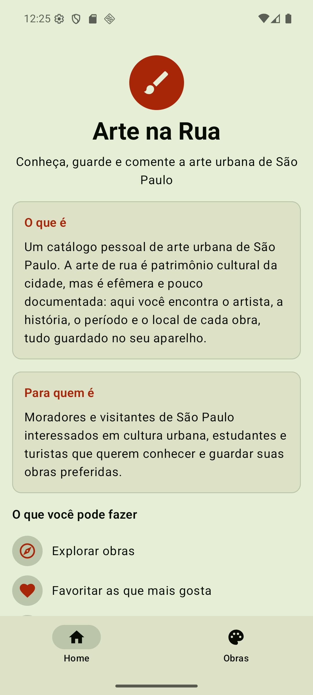 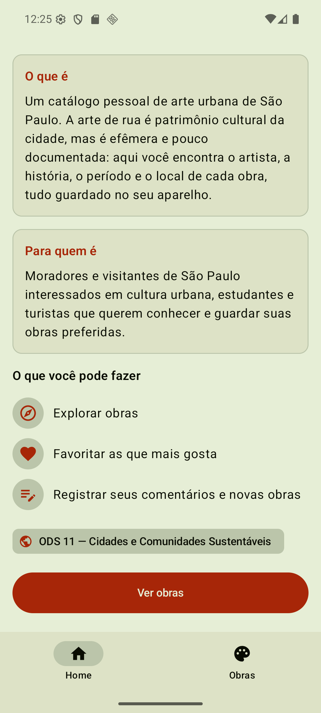

### 2. Listagem, favoritos e filtro (ação adicional)

Na primeira abertura aparecem as 5 obras do seed. O coração favorita a obra; o filtro **Favoritas** mostra só as marcadas.

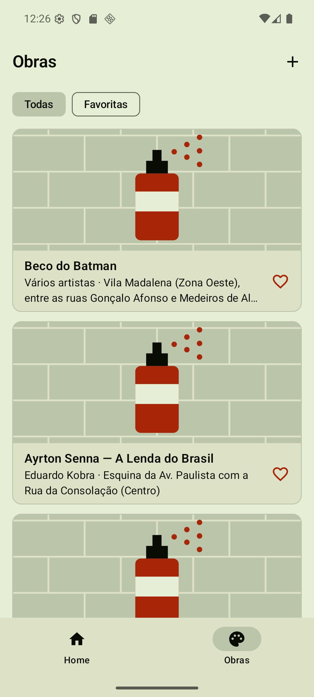 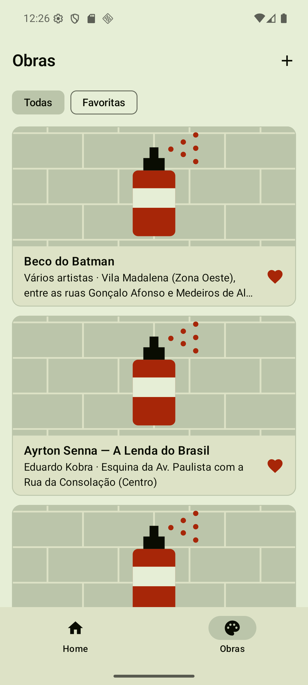 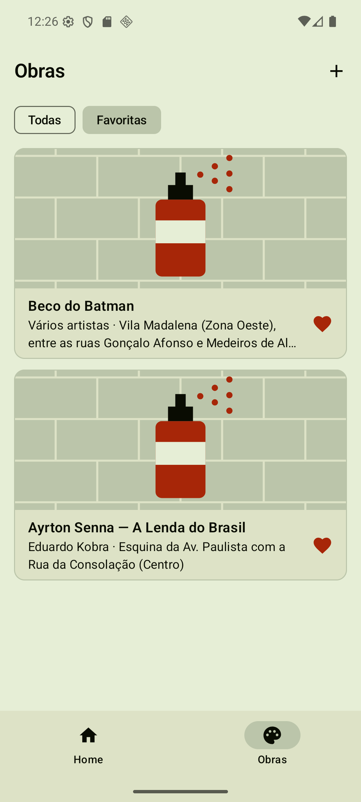

### 3. Detalhe e comentário (ação adicional)

O toque no card abre o detalhe. O comentário pessoal é adicionado, editado e removido nesta tela.

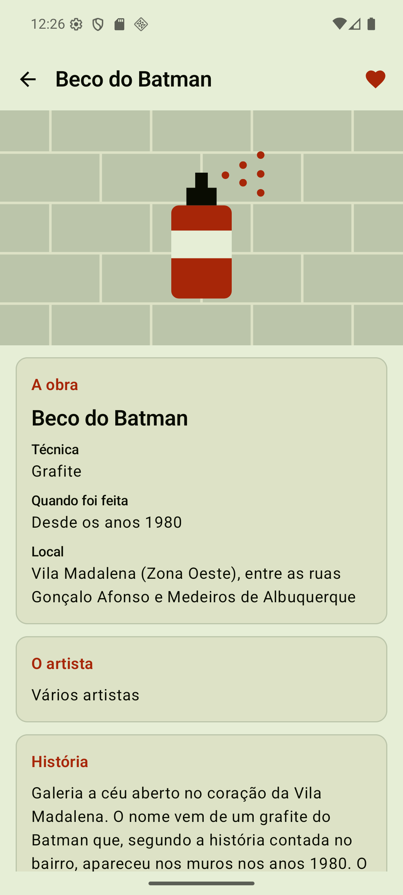 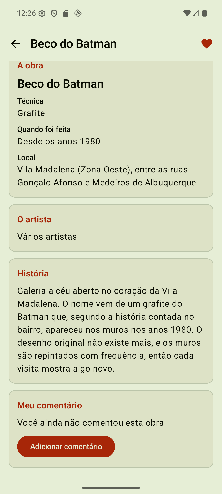 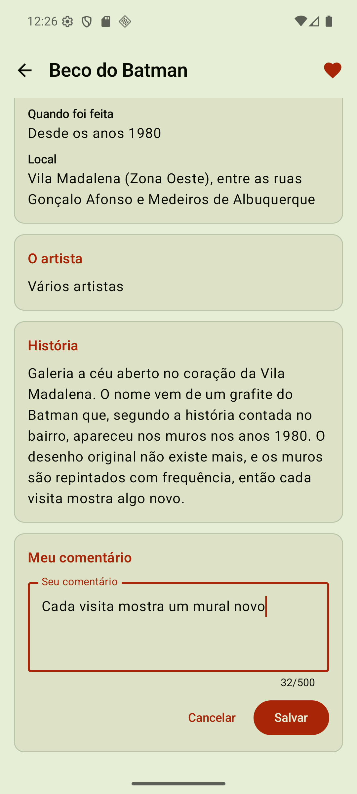 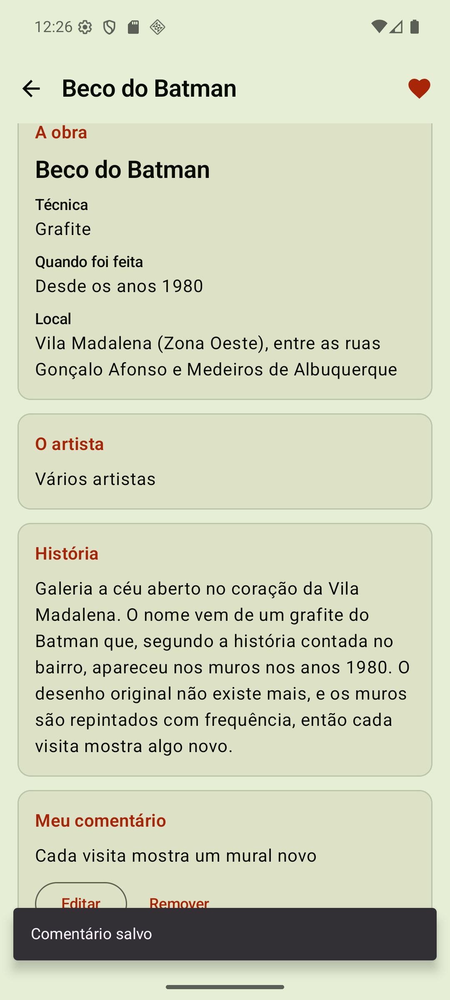

### 4. Cadastro (criação de um registro)

O **+** da listagem abre o cadastro. Com campos obrigatórios vazios, cada um mostra seu erro e nada é gravado; com tudo preenchido, a obra é salva e aparece na lista.

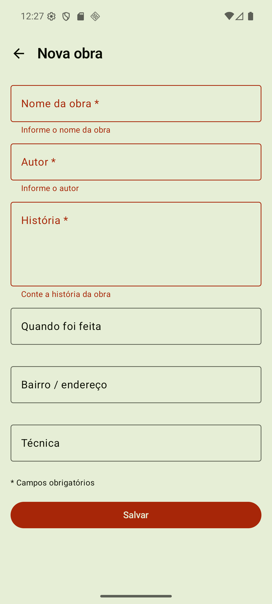 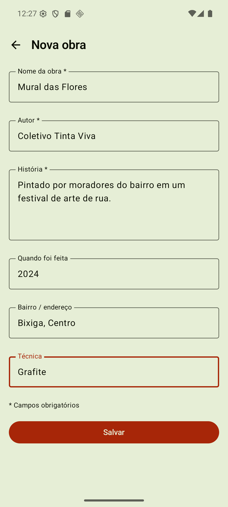 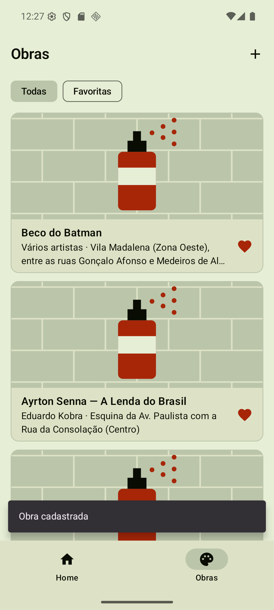 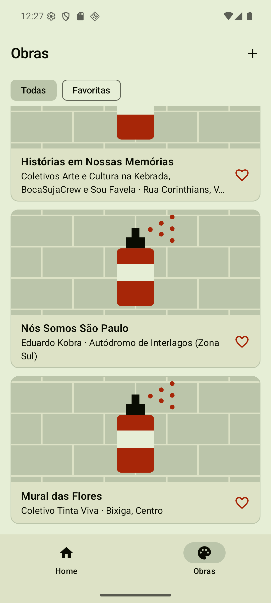

### 5. Permanência após reabrir o app

Depois de fechar o app por completo (`force-stop`) e abrir de novo, os favoritos, a obra cadastrada e o comentário continuam lá (compare com os prints 04, 13 e 09).

  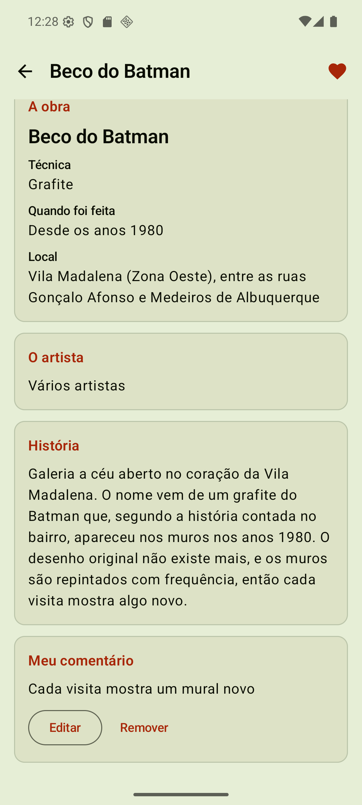

## 6. Video demonstrativo 

https://drive.google.com/file/d/1wPo0pDfteir6ke6DmZSJOg1XwYZo3ByG/view?usp=sharing
